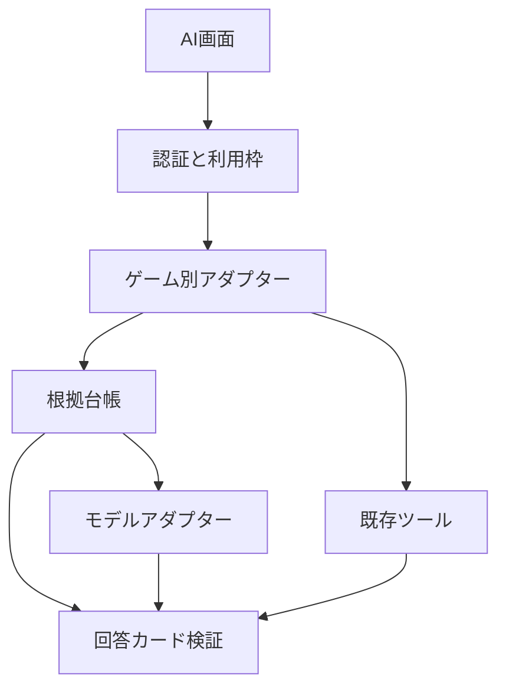

# Game Kid/s AI 実装仕様

調査基準 2026-11-25（JST）  
GitHub `RyoVBBoy/pokechan-hub` / `main` の `31ed89eae41352fbac330f9f5ba84cc1c5d4e6c2`  
実装ブランチ `feature/gamekids-ai`

## 1. 着手範囲とリリース条件

| 段階 | 実装範囲 | 完了条件 |
|---|---|---|
| A — 今回の引き継ぎ | Pokémon Championsの日本語テキスト画面、型付き根拠・回答カード、図鑑と安全な計算ケースの実データ連携、診断・構築・選出・使用率の条件付き連携、Firebase会員の枠、コスト台帳、模擬AIアダプター、オフライン評価 | 専用ブランチでビルド・既存テスト・新規テストに合格し、実測値と未対応範囲を引き渡す |
| B — 別途承認後 | 許可済み提供元を非公開環境で比較。安全な自由文からの質問解釈、計算アダプターの対応拡張、実ユーザーβ候補 | 独立監査で精度・費用・プライバシー・障害時動作を確認 |
| C — 別途承認後 | 月額課金・有料限定機能。必要に応じて回答下の広告、画像入力、別タイトル | 機能ごとに規約・データ利用条件・公開判定を通過 |

AはUI・APIとも既定無効。ローカル検証は模擬アダプターとテスト用DBを使用。専用ブランチの変更に限定し、継続精度監査・リンク投稿・本番実装のブランチやデプロイ設定とは独立させる。本番シークレット、外部AIの実呼び出し、契約、課金、デプロイ、mainへのマージは対象外。既存ツールは通常の入口から引き続き利用できること。実装後はコミットSHA、差分、テスト出力、計算対応表、差異・未検証点をGPTの独立精度・セキュリティ監査へ渡す。修正後は同じSHAで再検証し、公開には遼の承認を得る。

## 2. 最新mainで確認したこと

ソースのリンク先は[調査時の固定コミット](https://github.com/RyoVBBoy/pokechan-hub/tree/31ed89eae41352fbac330f9f5ba84cc1c5d4e6c2)。

| 対象 | 確認した入口 | AIへの適用 |
|---|---|---|
| ビルド | `tools/build.mjs`、`src/js/order.json`、`worker/build.py` | PagesはJS連結、Workerは既存の関数・データを抽出して組み立てる。Aでフロントのフレームワークを追加しない |
| ゲーム | `src/js/27-games.js` の `GAMES`、`curGame()` | 既存ID `pokechamp` を採用。画面のゲーム切り替えは `MULTI_GAME=false`。AI内では最初からゲームの境界を強制する |
| 認証 | `src/js/29-account.js` の `authFetch`、`worker/src/auth.js` の `authOf` | Firebase署名済みBearerで本人確認。既存の `COMM_API` にはローカル設定からの上書きがあるため、AIは固定の許可済みAPI先を使い、本番で任意ホストへBearerを送らない |
| 図鑑 | `08-dex.js`、`09-pokemon.js`、`79-dexpage.js`、`17-sources.js` | 種族・フォルム・技のIDと参照先を再利用。既存の項目単位の出典・公開検証記録を照合し、ローカルの確認フラグによる昇格を禁止 |
| ダメージ計算 | `21-calc.js` の `dmgRolls`・`koInfo`、`worker/build.py` | Workerで共有済みの `bcalc` だけでは現行画面と同等にならない。必要な既存関数を同じソースから取り込み、UIと一致した入力契約だけを有効化 |
| パーティ診断・構築 | `60-diag.js` の `dgTeam`、`62-improve.js` の `dgImprove`、`76-mvp.js` の `mvpEvalTeam`、`77-teambuild.js` の `tbAnalyze` | 生の画面状態や大量計算をWorkerへ持ち込まない。既存画面の結果をローカルでカード化するか、未実行なら既存機能を開く。評価は「当サイトの計算上の目安」と明示 |
| 選出 | `16-assist.js` の `analyze`・`assistView`、`61-select.js` の `dgSelect` | 選出アシストと診断内の選出評価を区別。形式・候補集合・相手の型の仮定を明示。対戦の勝敗は保証しない |
| 使用率 | `worker/src/usage.js` の `usageBuild`・`usageApi`、`src/js/43-usage.js` | `seen`、`builds`、`ranked_builds`、`battle_builds` は母集団が異なる。現行の保存育成 `builds` は形式で絞られず、分母や期間の扱いも項目別。形式別・公式環境の根拠から除外。Aでは形式・観測件数・期間・更新時点を満たす `seen` の公開集計だけを採用し、20件未満は表示しない。30日枠内の集計上限・重複除外も表示または説明に反映。現行の重複判定に形式が含まれないため、記録されたサンプルの割合として扱う。取得から6時間を超える、生成時刻・件数が欠ける、要求期間を特定できない場合は数値を保留。外部のChampions Battle DataやPokéKitは利用条件確認と新規承認までAIコーパス・再配布・外部送信の対象外 |
| 既存AI | `worker/src/worker_src.js` の `oppReadApi`、`worker/src/replay.js`、`worker/src/collect.js` | 画像・振り返り・集計の既存経路は別機能。自動モデル探索・再送・提供元フォールバック・既存キーは攻略AIで共有しない |
| CI／公開 | `.github/workflows/deploy.yml`、`tests/run.mjs` | mainへのpush、手動起動、定期実行が公開経路。専用ブランチの検証は権限・シークレット不要のローカルまたは非デプロイCIに限定し、この公開ワークフローを手動起動しない |

公開Workerのバインディング、提供元の契約状態、本番バンドルとの一致、実機結果はこのソース調査の対象外。既存の認証や出典コードは独立監査でも確認する。

## 3. 共通基盤と入出力

フロントは既存のツール画面に、対象ゲーム・対戦形式、質問、根拠、残り枠を表示する日本語画面を追加する。自動履歴保存・広告・画像入力はAで無効。Workerの `/api/ai/v1/context`（利用可否・対応範囲・枠）と `/api/ai/v1/answer`（質問）を、コミュニティ用DB初期化や共通JSON読み取りより前に分岐し、既存のレスポンス保護を維持する。自身の明示設定が無効なら、DBや提供元へ接続する前に終了する。AI応答は常に no-store。認証なし401、許可なし403、形式エラー400、本文過大413、枠不足429（再開時刻を添える）、一時停止・依存障害503。業務上の保留は200で状態と理由を返す。



- リクエストは `{gameId, format, requestedRulesetId?, question, toolInput?, requestId}`。形式は `single|double`。ゲーム、ルール、ID、AP、持ち物、技、フォルムの許容値はサーバー側で厳格に検証する。対象・形式・場・メガ化・型など、答えを変える入力が曖昧なら `needs_input`。提供元やクライアントからの任意スコープ・外部URL・ツール名を実行しない。
- ゲーム別アダプターの契約は `resolveScope`、`resolveEntities`、`findEvidence`、`runTool`、`getCapabilities`。スコープは `{gameId, rulesetId, format, dataRevision, engineRevision}`。ゲームパッチとレギュレーションの適用期間をマニフェストに記録。種族の全形式共通項目は明示的な `formatIndependent` のみ共有。レギュレーションやパッチが確認できない規則・合法性・期間依存データは保留。ゲーム未対応は `unsupported`。他ゲームの根拠・エイリアス・キャッシュ・ツールへフォールバックしない。
- 項目別の根拠レコードに `evidenceId, scope, entityId, field, typedValue, sourceType, sourceRef, checkedAt, validFrom, validTo, status` を持たせる。出典は管理されたリンクまたは検証記録ID。由来や実装リビジョンはメタデータに含め、ビルドでスキーマ、重複、参照切れを検査する。検索は同スコープで日本語エイリアス・英語名・IDの正規化検索とみなし、最初は静的索引。名前の近さは候補表示に使い、フォルムを勝手に決定しない。ベクトルDB、追加学習、動的ウェブ検索はAで採用しない。
- 回答は `{status, scope, cards, evidence, reasonCode?, nextAction?, usage, requestId}`。状態は `answered|partial|needs_input|insufficient_evidence|unsupported|unavailable`。カードに `templateId, slots, evidenceIds, verificationStatus` を付ける。根拠種別は「公式資料」「実機で確認」「外部参照と一致」「サイトの計算・推定」「当サイト集計」「根拠不足」。主張単位で表示し、実機試験と参照実装の一致を別扱いにする。同一データ由来の一致は独立照合とみなさない。矛盾・失効・別形式は保留し、確実な部分だけを `partial` で返す。
- 数値・技名・条件・引用は検証されたカードのスロットをサーバーが埋める。モデルに渡す出力スキーマは許可されたテンプレート・列挙ID・質問解決候補だけ。未取得のID、矛盾する主張、自由生成の断定・引用・説明文は描画せず、検証器が決めた定型文へ落とす。表示はプレーンテキストと許可済みリンク。入力が足りないときは「条件を確認できると計算できます」等、必要条件を示す。
- Aの計算は、まず単発の威力固定技・明示されたフォルム・技と型・固定の明示条件のケースを対応表に載せる。最初の条件は通常フォルム、ランク0、満タン、場・状態・持ち物・急所なし、等倍の単体攻撃。特性も当該計算に影響しないものを許可表で指定する。シングル・ダブルの対応は形式別の照合結果に基づく。入力の合法性を確かめられない型は計算対象外。入力にない前提を補わず、連続技・特性・場・メガ・急所・乱数処理の個別対応は差分テストで一致した契約だけを登録する。計算カードにはレンジ、対象HP、前提、出典、計算リビジョンを表示。対象外なら条件を保持できる安全な導線で既存計算へ。
- 診断・構築・選出はAで、既存画面から利用者が明示的に選んだ計算済み結果のローカル表示と、元機能への導線を用意。未実行なら結果を生成せず、画面を案内。元結果のゲーム・形式・版と現在コンテキストが一致する場合だけ表示。ブラウザーから送られた計算値をサーバー検証済みと表示しない。生の保存パーティ、DM、ユーザーデータはモデル入力に含めない。
- `Provider.generatePlan(input, schema, limits, signal)` は構造化結果、使用量、内部エラー種別を返す。Aでは `MockProvider` と提供元を切り替える契約テストのみ。Bは設定済みの単一提供元と固定モデル・プロンプト版を使う。モデルを変えるたび固定評価を再実施。画像は将来、別の `extractEvidence` 能力として追加可能にし、読取結果はあくまで候補。明示同意、実画像保管を最小化、容量・画素上限・メタデータ除去、照合・本人確認の段階を通す。

## 4. 利用枠、月額課金、広告

- 既存Firebase会員に無料枠を付与。Aの検証初期値は無料 5回/日かつ30回/月、有料テスト権限 300回/月。全プランに短時間の頻度制限、同時1件、全体予算を設ける。時刻はJST日付と月初を使用。有料契約の更新やプラン変更でも当月消費は引き継ぐ。上限はサーバー設定。Aでは購入画面・実決済・実プラン価格の設定を行わない。
- 利用枠は利用者単位で、費用予算は提供元に対する全体費用。受付時は `requestId` と正規化した入力の短期鍵付きハッシュを照合し、会員枠・最大費用・同時枠をひとまとめに予約する。無効・未対応・根拠不足・提供元失敗のときは会員枠を消費しない。同一IDの重複は新規推論も二重計上もせず、完了状態と必要なら再試行の案内を返す。異なる入力で同じIDを使う場合は409。
- Cloudflare D1の独立した `AI_DB` に移行SQLを置く。単純なSELECT後UPDATEで上限を判定せず、主DBで条件付きINSERTとトリガーまたは整合が確認できるアトミックな更新を用いる。予約と、有効期間・標準単価込みの最大費用（整数マイクロUSD）を同時確定。外部送信直前に状態を記録し、結果・予約解放・実使用量を冪等に更新。通信タイムアウトや使用量不明の送信済み処理は最大費用を保持し、精算が確定した時だけ減額する。失効回収は会員・同時枠を戻すが全体費用を安易に戻さない。DB・台帳・価格設定に障害があれば提供元を呼ばない。Aの財布はテスト値、Bの実上限は承認後設定（未設定は実呼び出し無効）。
- 有料機能はサーバー管理の `entitlements` で判定。CではStripe Checkout・Billingを候補にする。署名・時刻を生ボディで検証したWebhookを使い、イベントIDを一意に処理。重複・順不同に備え、現在の契約情報で権限を整合させ、解約・未払い・返金時の更新ルールをテストする。ブラウザーの決済完了画面から権限を付与しない。
- 表示例「AIの利用には処理費用がかかるため、サイト運営を続けながら、みなさんが公平に使えるよう回数に上限を設けています。」残り回数とリセット時刻を表示する。
- 広告はCの任意検討。利用者は回答と出典を読み終えた後に、明示ラベル付きの広告領域を見る。広告事業者へ質問文・回答・アカウント情報を渡さず、第三者タグ・CSP・未成年者向け設定・誤タップ・速度・規約を独立審査。収支試算に広告売上を含めない。

## 5. 技術選定と費用

2026-11-25確認。公開の標準料金で1回あたり入力2,000・課金出力500トークン（思考分含む）、1モデル呼び出し、キャッシュなしと仮定。円は為替の仮置き1ドル150円。税、Workers/D1、決済、監査、再試行、OCR・画像、評価・運用費は別。

| 選択肢 | 入力／出力 USD/100万 | 1千回 | 1万回 | 10万回 | 判断 |
|---|---:|---:|---:|---:|---|
| 根拠カード＋MockProvider | 0／0 | $0 | $0 | $0 | Aで採用。既存基盤の処理費用は別 |
| OpenAI GPT-6 Luna | 0.10／0.50 | $0.45 | $4.50 | $45 | Bの比較初手。必要な未成年者対策とデータ条件を確認 |
| Anthropic Claude Haiku 5.5（短文単価） | 0.10／0.50 | $0.45 | $4.50 | $45 | Bの比較候補。同一日本語のトークン数差、利用条件・保持条件を測る |
| Google Gemini 3.1 Flash-Lite（有料） | 0.25／1.50 | $1.25 | $12.50 | $125 | 価格参照。18歳未満に向けた、または利用が見込まれるAPIクライアントに関する契約上の制限があるため一般公開候補から外す |
| OpenAI GPT-6.1 Terra | 1.00／5.00 | $4.50 | $45 | $450 | Bで安価な候補が精度基準を満たせない場合の比較用 |

1万回は上から約0円、675円、675円、1,875円、6,750円。無料枠まで使う会員1,000人なら月3万回でLuna仮定 $13.50、上限300回の有料会員100人分も同額。有料価格の検討は、P95実測トークン×上限、決済手数料、基盤・運用費、想定の無料利用負担を見てから行う。Aの設計上限は最大入力2,000・課金出力500・モデル1回、モデル側の課金出力上限が実際に効くことをBの条件にする。文字数からトークンを過小見積もりしない。予算管理では実測平均の代わりに最悪時の予約額を使う。Workers/D1は試行前にアカウント実枠と日次読み書き・CPU、Stripeは日本の実契約の料率とBilling手数料を確認する。

## 6. セキュリティとプライバシー

- Firebase認証は既存検証を再利用し、AI会員・停止・権限をサーバーで照合。Bearerの送信先とブラウザーOriginは厳格な許可リスト。CORSは認証の代替にしない。テストと本番のキー・DB・許可Originを分離。AI用の鍵をWorkerシークレットに置き、フロント、生成物、Git、ログに入れない。
- JSON本文はストリームの実バイトで8 KiB、質問は1,000文字、モデル候補の数と回答カード数も制限。Content-Type・追加フィールド・配列の長さを検証。パラメーター化SQL、型・値・所有権の検証、固定提供先、最大応答サイズ、15秒以内のタイムアウト、実呼び出しの再送なし。外部呼び出し前に会員・IP・全体の各頻度上限を適用し、IPは日次の秘密鍵付きハッシュで短期保持。コスト急増、異常率、提供元障害に停止スイッチ。
- モデルはユーザー入力や資料を命令として扱っても権限が増えない。ツール権限はサーバー側で読み取り用に限定し、チャットから書き込み・支払い・公開・任意URL取得の道を持たせない。返答の検証に失敗したら安全な表示へ。提供元エラー・鍵・元入力をレスポンス本文へ含めない。
- 履歴の永続化と全文ログは既定無効。メトリクスは件数、スコープ、モデル・版、トークン、費用、時間、分類コードに限定し、個人別枠の識別子はAI用鍵でハッシュ。IPと重複防止情報は24時間を目安に自動削除、会員枠は月次集計の照合に必要な期間（初期90日）で削除。会員削除で関連枠を削除するが、全体の匿名費用集計は保持。削除連携は既存の削除認証と本人IDを再利用し、AI側の処理は冪等な再試行と期限削除を備える。AI障害で既存の退会経路を塞がない。Bの外部送信は必要最小限の検証済み根拠と構造化意図を優先し、自由文を送る設計は明示同意と送信前の個人情報対策が前提。検出で全ての個人情報を排除できるとは扱わない。外部プロバイダーの保持・学習・処理地域・未成年者・削除条件と、日本の個人情報保護法上の扱いをB開始前に審査。現行の画像機能の契約済み・適法性もこの調査では判定しない。

## 7. テスト仕様と合格基準

Aではプロバイダーをモックし、期待値に一次資料・固定データ版・既存ツールの計算結果といった参照を付ける。生成用と別に固定評価を設け、失敗例の差し替えで合格にしない。Bは同じ固定セットで実アダプターを比較し、手元にない実機結果を外部参照で代用しない。

| スイート | 最低件数／対象 | 合格条件 |
|---|---|---|
| 根拠・図鑑 | 40。技・特性・AP・メガ・日本語同名候補・未確認仕様 | 回答した事実・リンク・検証ラベルが100%根拠に一致。別ゲーム・ゲーム版・形式の混同0件 |
| 計算 | 40。対応ケースの乱数・確定数、未対応の連続技・場・特性等 | 対応範囲で現行画面の同条件結果と全件一致。未対応に数値を表示しない |
| ツール／使用率 | 30。診断・構築・選出、形式、集計閾値、期限、権利未承認ソース | 元結果・仮定・出典・期間・分母が一致。誤集計やメガ・選出条件の混同0件 |
| 保留・ゲーム分離 | 30。根拠欠落・競合・失効、架空第2ゲーム、異形式・異版 | 必須保留が100%。回答可能とラベルした集合の回答率95%以上 |
| 防御・障害 | 40。認証不成立・権限不足・入力境界・未許可Origin・無害な命令混入例・未知の引用ID・DB／提供元障害・無効設定 | 権限外操作・秘密／他者データ露出・勝手な外部送信・規約外データの利用・費用上限の突破0件 |
| 利用枠・会員 | 20。並列50受付、同一ID、更新境界JST、失効回収・請求不明・会員削除 | 実D1互換ランタイムでも予約・上限・二重消費・停止・削除が全件整合 |
| 既存回帰 | `npm run build` と `npm test`、ログイン・主要ツールのデスクトップ／スマホ検証 | 既存スイート全件と新規スイートを通す。既知不安定ケースは同じ基準SHAでも再現性を記録し、素通し扱いにしない |

固定評価は最低200件（既存回帰を除く）。根拠がある事実の支持率、必須保留の再現率、回答可能ケースの回答率を別々に記録する。実提供元の比較は同じ200件を各3回、同じ評価データで行い、重大誤答・根拠捏造・誤権限・費用超過は計測期間内0件。候補の選定順は合格、回答率、P95待ち時間、1,000件実効費用。βの目標は日本リージョンからP95 8秒以内、タイムアウトは15秒以内。未達なら模擬アダプターと根拠カードで開発を続け、実提供元は公開判定を保留する。

## 8. 参照

- [Pokémon Champions公式・レギュレーション入口](https://champions.pokemon.com/en-us/)
- [Cloudflare D1のbatch・整合性](https://developers.cloudflare.com/d1/worker-api/d1-database/) / [D1料金](https://developers.cloudflare.com/d1/platform/pricing/) / [Workers料金](https://developers.cloudflare.com/workers/platform/pricing/)
- [OpenAI Luna](https://developers.openai.com/api/docs/models/gpt-6-luna) / [Terra](https://developers.openai.com/api/docs/models/gpt-6.1-terra) / [APIデータ管理](https://developers.openai.com/api/docs/guides/your-data) / [未成年者向けAPIガイダンス](https://developers.openai.com/api/docs/guides/safety-checks/under-18-api-guidance)
- [Claude Haiku価格](https://platform.claude.com/docs/en/models/haiku-5-5/overview) / [構造化出力](https://platform.claude.com/docs/en/build-with-claude/structured-outputs) / [APIデータ保持](https://platform.claude.com/docs/en/manage-claude/api-and-data-retention)
- [Google Gemini価格](https://ai.google.dev/gemini-api/docs/pricing) / [構造化出力](https://ai.google.dev/gemini-api/docs/structured-output) / [API追加規約](https://ai.google.dev/gemini-api/terms)
- [Stripe Webhooks](https://docs.stripe.com/webhooks) / [日本向け価格](https://stripe.com/jp/pricing) / [広告配置ポリシー](https://support.google.com/adsense/answer/1346295?hl=en)
- [OWASP Prompt Injection](https://genai.owasp.org/llm2026/llm012026-prompt-injection/) / [個人情報保護委員会ガイドラインQ&A](https://www.ppc.go.jp/personalinfo/faq/APPI_QA/)

## Claude Codeへの指示

```text
On feature/gamekids-ai, read docs/ai/implementation-spec.md and implement Stage A only. Follow the pinned main evidence, reuse existing engines, and keep AI disabled by default. Use mock inference, versioned evidence, validated cards, separate quota storage, and read-only tool integrations. Run the build, full regression suite and acceptance matrix, including D1 concurrency. Report the diff, test counts, parity gaps and commit SHA for independent review. Keep all work on this branch. No live API, billing, deploy, or merge.
```
